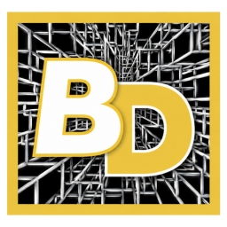
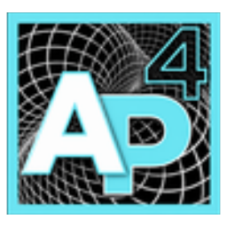
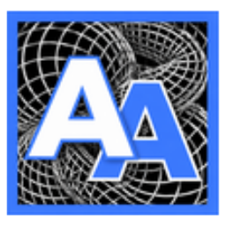

<!-- README-LANGUAGES -->

<a href="README.md">English</a> &nbsp;|&nbsp; <strong>Deutsch</strong>

# BlockDesign – Deutsch

[English README](README.md) · [Releases](https://github.com/landjunge/BlockDesign/releases)

## Downloads

Die fünf vorgesehenen Installer sind noch nicht als geprüfte Installationsdateien nachgewiesen. Die grauen Felder sind keine Download-Links.

  

  
  &nbsp;
  
  &nbsp;
  
  &nbsp;
  
  &nbsp;
  

<picture><source media="(prefers-color-scheme: dark)" srcset="assets/design/wordmarks/BlockDesign-dark.svg"></picture>

<!-- AUTO-DOWNLOADS:START -->

  
  &nbsp;
  
  &nbsp;
  
  &nbsp;
  
  &nbsp;
  

<a href="https://github.com/landjunge/BlockDesign/archive/refs/heads/main.zip">Quellcode herunterladen / Download source ZIP</a>

<!-- AUTO-DOWNLOADS:END -->

Die ausführliche deutsch- und englischsprachige Projektdokumentation steht in der [Haupt-README](README.md). Die Quellcode-Datei ist kein nativer Installer.
